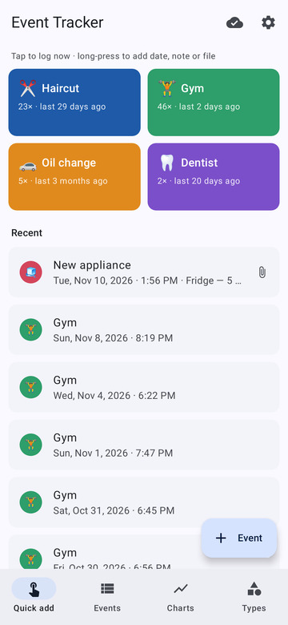
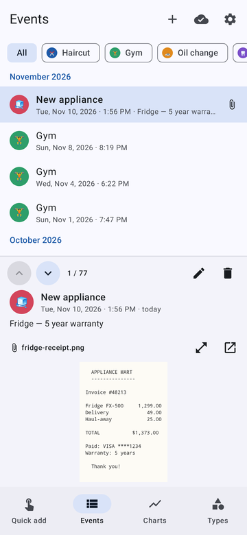
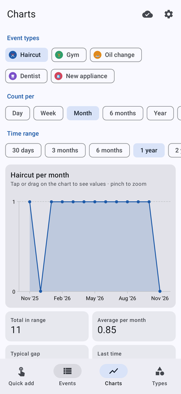
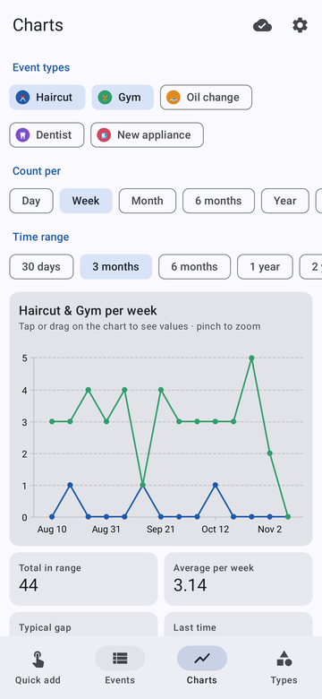

# Event Tracker

A private Android app for logging life events ("Haircut", "New fridge", "Oil change", ...) with
one tap and seeing how often they happen. Everything is stored in **your own Google account**: a
Google Sheet plus a Drive folder for attached files (receipts, invoices, photos). The app keeps a
copy on the phone so it's instant and works offline, and syncs every change to Google in the
background.

<p>




</p>

## Features

- **Event types**: add, rename, recolor, give an emoji, delete (deleting a type also deletes its
  events). Each type can be a **preset**: a one-tap button on the Quick add screen.
- **Events**: tap a preset to log it *now* (with Undo), long-press a preset or use **+ Event** to
  pick the date/time, add a note, and attach a file (any file, or take a photo). Edit and delete
  any event.
- **Charts** (powered by [Vico](https://github.com/patrykandpatrick/vico)): pick one or more types
  and see a line graph of how many times they happened per **day, week, month, 6 months, year, any
  number of days, or any number of months**, over the last 30 days / 3 / 6 months / 1 / 2 / 5 years,
  all time, or a custom date range. Tap the chart for exact values, pinch to zoom. Below the chart:
  total, average per period, typical gap between events, time since the last one, and the list of
  occurrences.
- **Events list + file viewer**: the list shows all events by month. The pane below (beside it on
  a tablet or in landscape) shows the selected event and its attached file **read-only**: images
  (pinch to zoom, double-tap), PDFs (all pages), text files; anything else opens in another app.
  Move with the **▲ ▼ buttons** or a keyboard's **↑ ↓** (also `j`/`k`; `Enter` edits).
- **Offline first**: changes are applied instantly, queued on the phone, and written to Google in
  order when there's a connection. The cloud icon in the top bar shows the sync state and the
  number of changes waiting.

## Where your data lives

The app only asks for the `drive.file` permission, so it can see **only the files it created**,
nothing else in your Drive. It creates:

```
My Drive / Event Tracker /
    Event Tracker Data        ← spreadsheet: EventTypes, Events, Shards tabs
    Event Tracker Events 2    ← created automatically when the Events tab is full (see below)
    Event Tracker Events 3    ← ...
    Attachments/              ← uploaded receipts, invoices, photos
```

| Tab          | Columns |
|--------------|---------|
| `EventTypes` | `id`, `name`, `color`, `emoji`, `preset`, `createdAt` |
| `Events`     | `id`, `timestamp` (epoch seconds), `typeId`, `note`, `fileLink`, `fileId`, `fileName`, `fileMimeType` |
| `Shards`     | `seq`, `spreadsheetId`, `link`, `createdAt`: the chain of spreadsheets that hold events |

**Automatic splitting (sharding).** So no single sheet grows unmanageably large, events are spread
over a chain of spreadsheets. New events go to the newest one; when it reaches 10,000 rows
(`SheetsBackend.MAX_ROWS_PER_SHARD`) the app creates the next spreadsheet ("Event Tracker Events
2", 3, ...) and links it in the `Shards` tab. Reading follows the whole chain, but a spreadsheet is
only downloaded again if Drive reports that it changed, so syncing stays fast as your history grows.
Edits and deletes go straight to the spreadsheet that holds the event. If the app is ever killed
while starting a new spreadsheet, it links that spreadsheet on the next sync.

You can open the sheet from **Settings → Open Sheet** and edit it by hand; changes appear in the
app on the next sync. Rows you type in yourself can use the type's *name* in `typeId`. Deleting an
event (or replacing its file) moves the attached file to your **Drive trash**, where it can be
recovered for 30 days.

## One-time Google Cloud setup (about 10 minutes)

Google only lets an app use your Drive after you register it. This is free.

1. Open <https://console.cloud.google.com/> with your Google account and create a project
   (e.g. "Event Tracker").
2. **APIs & Services → Library**: enable **Google Drive API** and **Google Sheets API**.
3. **Google Auth Platform** (or "OAuth consent screen"):
   - *Branding*: app name "Event Tracker" and your email.
   - *Audience*: user type **External**. Under *Test users* add your own Gmail address.
     Optional: click **Publish app**. The app only uses non-sensitive scopes, so no Google review
     is needed. While the app is in *Testing*, Google may ask you to approve access again about
     once a week; the app shows a **Reconnect** button when that happens.
4. **Clients → Create client → Android**:
   - Package name: `io.github.ddastoor.eventtracker`
   - SHA-1 certificate fingerprint: `6F:C2:11:DA:5F:58:53:0F:0A:DE:30:95:50:87:A4:4E:82:3B:8D:40`

   (Both values are also shown in the app under **First-time setup info** on the sign-in screen,
   with copy buttons.) No client ID needs to be put into the app.
5. Install the APK, tap **Sign in with Google**, pick your account and allow access. The app
   creates the folder and spreadsheet on the first sync.

If sign-in says *error 10*, the package name or SHA-1 in step 4 doesn't match the APK. If sync says
an API "has not been used in project" or is disabled, finish step 2 (it can take a few minutes to
take effect).

## Installing the APK

- **From GitHub Releases**: once the signing secrets are set (see *Signing key* below), every push
  to the default branch (or a manual run of the *Build APK* workflow under **Actions**) publishes a
  release. On your phone open
  `https://github.com/ddastoor/eventTracker/releases/latest/download/EventTracker.apk`, then
  open the download. Android will ask you to allow installing apps from your browser once.
- **From any build**: open the workflow run under **Actions** and download the
  `EventTracker-<n>` artifact (a zip with the APK inside).

Every build is signed with the same key, so new versions install as updates and keep your data.

### Signing key

Google sign-in recognizes the app by its package name plus the SHA-1 of the key that signs the
APK, and Android only installs an update if it's signed with the same key. That key is **not in
this repository** (the repository is public). Keep your copy of `eventtracker.jks` and its password
somewhere safe, like a password manager.

**For GitHub Actions builds**, add four repository secrets (*Settings → Secrets and variables →
Actions → New repository secret*):

| Secret | Value |
|--------|-------|
| `SIGNING_KEYSTORE_BASE64` | output of `base64 -w0 eventtracker.jks` (macOS: `base64 -i eventtracker.jks`) |
| `SIGNING_STORE_PASSWORD` | the keystore password |
| `SIGNING_KEY_ALIAS` | `eventtracker` |
| `SIGNING_KEY_PASSWORD` | the keystore password (same as above) |

Without them, CI still runs the tests and builds an APK, but signs it with a throwaway debug key that
Google sign-in rejects, so no release is published. Each workflow run's summary prints the SHA-1
the APK was signed with.

**For local builds**, put the key in `signing/` (ignored by git) next to a
`signing/signing.properties` file:

```properties
storeFile=eventtracker.jks
storePassword=...
keyAlias=eventtracker
keyPassword=...
```

To start over with a new key, create one with
`keytool -genkeypair -keystore eventtracker.jks -alias eventtracker -keyalg RSA -keysize 2048 -validity 12000`,
register its SHA-1 as another Android client in Google Cloud, and uninstall the old app before
installing the new build. Your data is safe in Google and comes back when you sign in.

## Building locally

Requirements: JDK 17+ and the Android SDK (`ANDROID_HOME` or `local.properties` with `sdk.dir`).

```bash
./gradlew assembleRelease      # APK at app/build/outputs/apk/release/app-release.apk
./gradlew testDebugUnitTest    # unit tests (sync queue, sharding, charts math, Google API client)
./gradlew testDebugUnitTest -Pscreenshots   # also renders the UI to PNGs (Robolectric + Roborazzi)
```

## Code map

| Path | What |
|------|------|
| `data/SheetsBackend.kt` | Spreadsheet layout, shard chain, row upsert/delete |
| `data/GoogleApi.kt` | Minimal Drive + Sheets REST client (OkHttp) |
| `data/Repository.kt` | Local state, offline change queue, background sync |
| `auth/GoogleAuth.kt` | Google sign-in via Play services `AuthorizationClient` |
| `stats/Stats.kt` | Bucketing events into periods and summary numbers |
| `ui/` | Jetpack Compose screens: Quick add, Events + viewer, Charts, Types |
